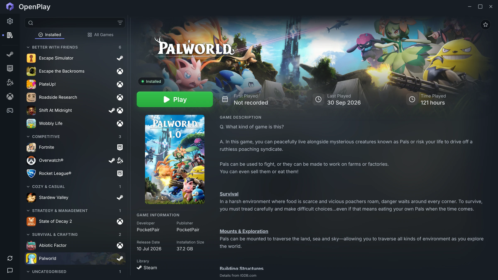
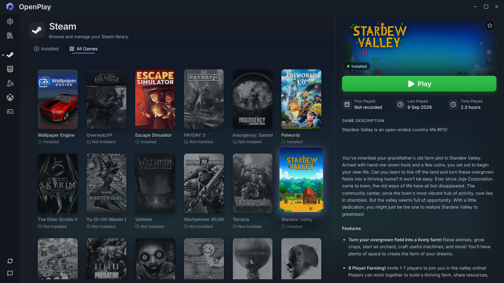
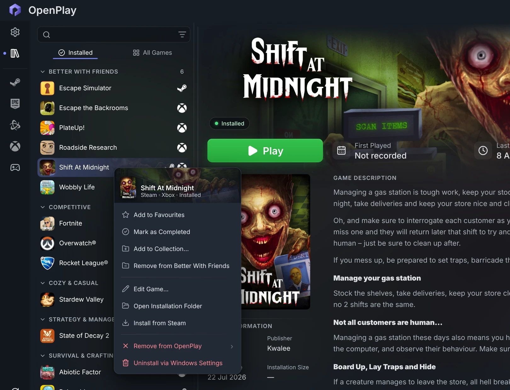
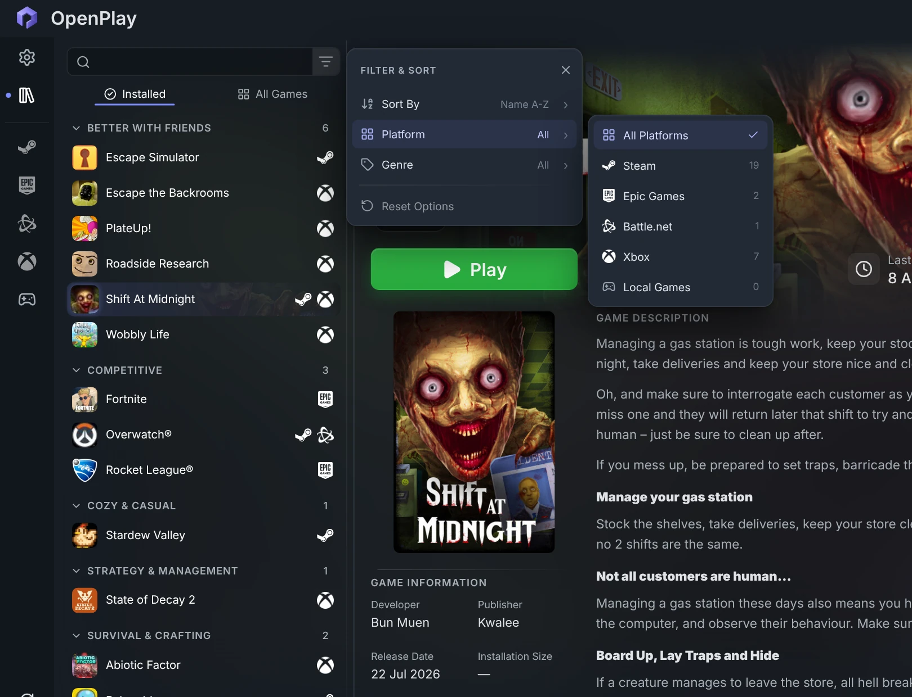
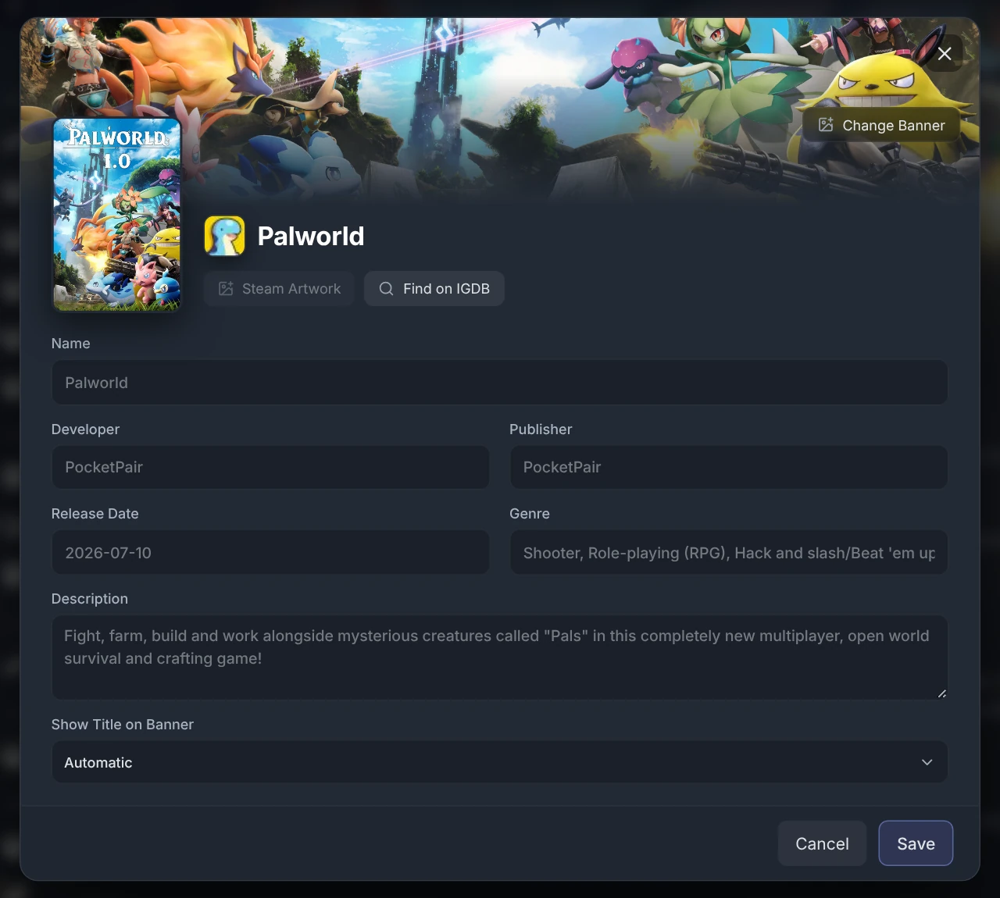
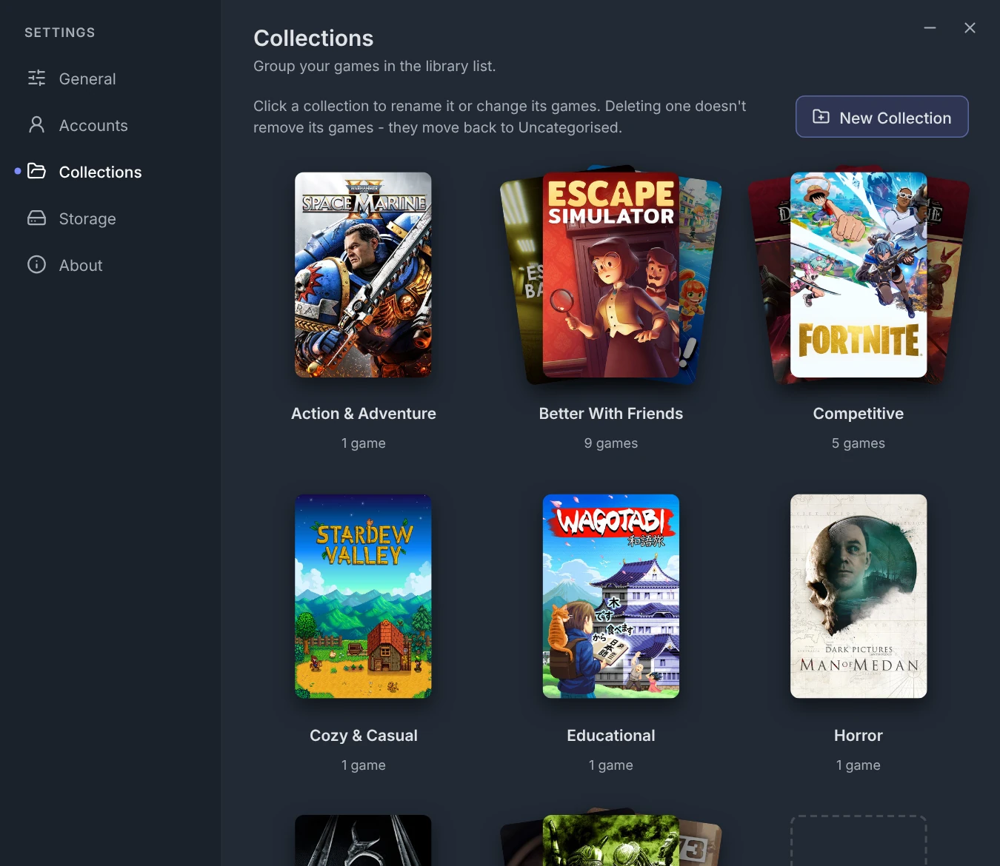
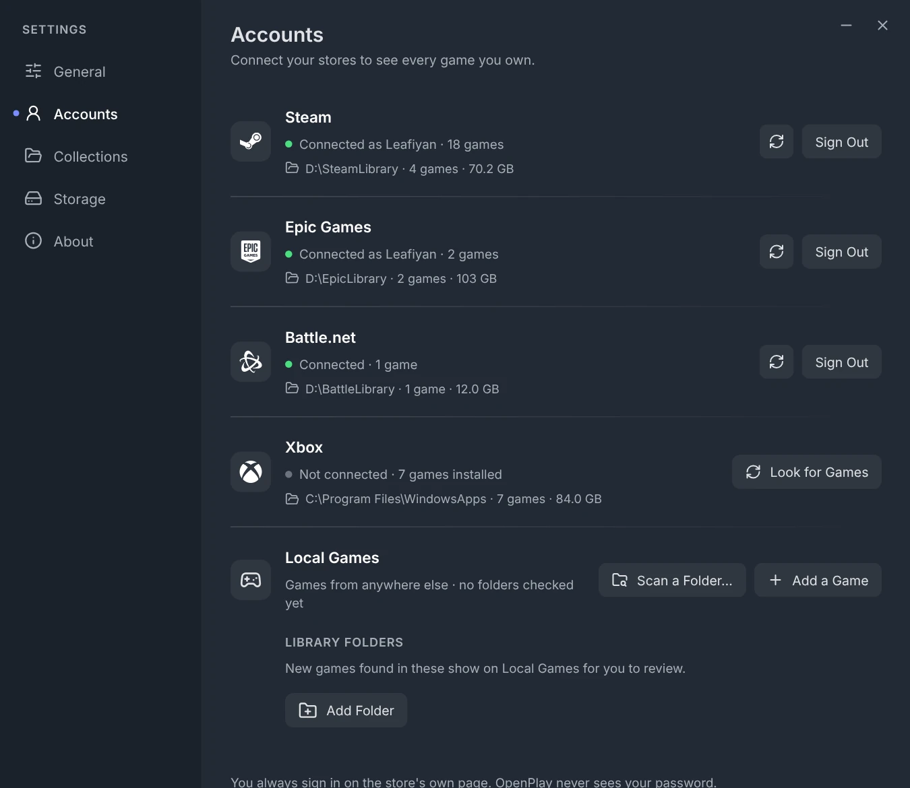
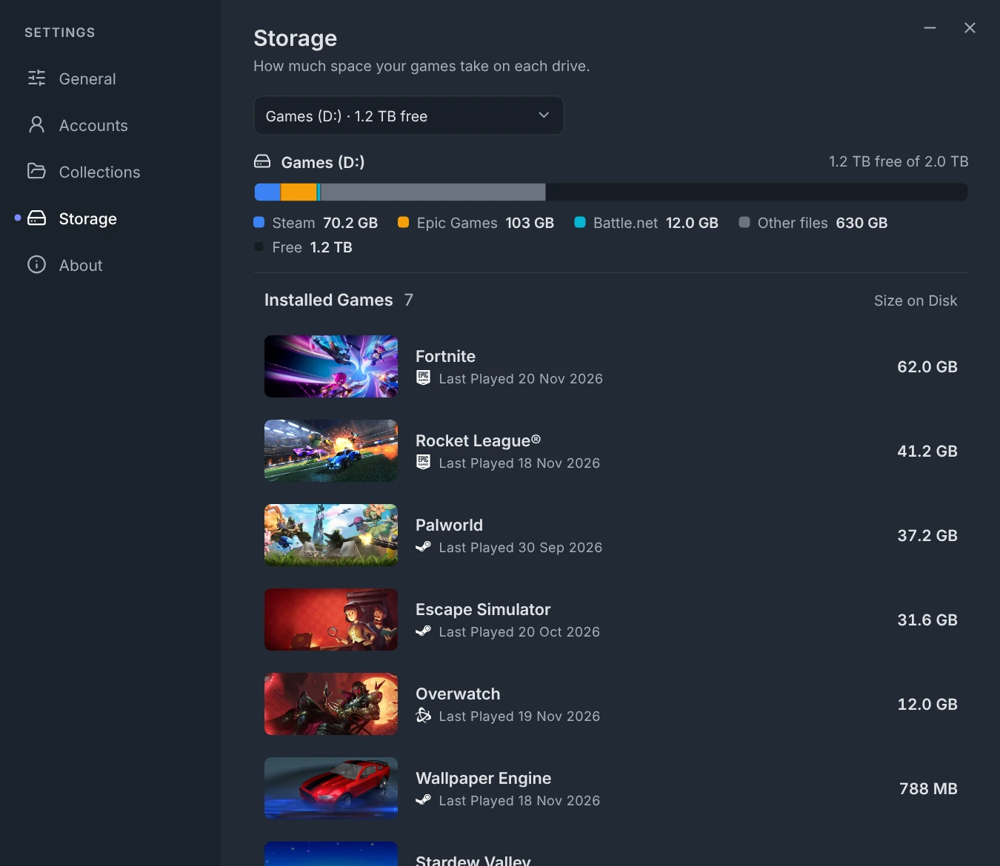

  

<h1 align="center">OpenPlay</h1>

  <strong>Every game you own, in one clean library.</strong> 
  A free game launcher for Windows that brings Steam, Epic Games, Battle.net, 
  Xbox / PC Game Pass and your own games together in one place.

  
  
  
  

  <a href="https://github.com/Leafiyan/OpenPlay/releases/latest/download/OpenPlay-Setup.exe"><strong>Download for Windows</strong></a>
  &nbsp;·&nbsp;
  <a href="https://openplaylauncher.com">Website</a>
  &nbsp;·&nbsp;
  <a href="https://discord.gg/U6gvrYwXPp">Discord</a>
  &nbsp;·&nbsp;
  <a href="https://openplaylauncher.com/roadmap">Roadmap</a>
  &nbsp;·&nbsp;
  <a href="#support-openplay">Support</a>

  

## Features

- **One library for every store.** Steam, Epic Games, Battle.net, Xbox / PC Game Pass and games you installed yourself, all in one list, installed or not.
- **One entry per game.** Own a game on more than one store? It shows once, and you choose which copy plays.
- **Artwork and details, done for you.** Clean banners, covers, logos, icons, descriptions, genres and release dates are found automatically from the game's store, Steam, SteamGridDB and IGDB, and kept up to date.
- **Collections.** Group games your way, like *Better With Friends* or *Cozy & Casual*.
- **Filter and sort.** By store, genre, name, recently played, favourites or completed.
- **Play statistics.** When you first and last played each game, and how many hours you've put in.
- **Make it yours.** Rename any game, fix its details, or choose your own cover, banner and icon.
- **Know your storage.** See how much space each store's games take up on every drive.
- **Simple by design.** No plugins, scripts or setup. Connect your stores and you're ready to play.

## Supported platforms

| Platform | Installed games | Owned games | Launch | Install / uninstall |
| --- | :---: | :---: | :---: | :---: |
| Steam | ✓ | ✓ | ✓ | ✓ |
| Epic Games | ✓ | ✓ | ✓ | ✓ |
| Battle.net | ✓ | ✓ | ✓ | ✓ |
| Xbox / PC Game Pass | ✓ | Coming soon | ✓ | ✓ |
| Games you installed yourself | ✓ | – | ✓ | Uninstall |

OpenPlay works alongside each store's own app: Steam, Epic, Battle.net and Xbox still download, update and run your games, and OpenPlay hands each game to the right one for you.

## Screenshots

<table>
  <tr>
    <td colspan="2"></td>
  </tr>
  <tr>
    <td colspan="2" align="center"><b>Browse each store's games</b></td>
  </tr>
  <tr>
    <td width="50%"></td>
    <td width="50%"></td>
  </tr>
  <tr>
    <td align="center"><b>Everything for a game in one menu</b></td>
    <td align="center"><b>Filter and sort your library</b></td>
  </tr>
  <tr>
    <td></td>
    <td></td>
  </tr>
  <tr>
    <td align="center"><b>Edit any game's details and artwork</b></td>
    <td align="center"><b>Organise games into collections</b></td>
  </tr>
  <tr>
    <td></td>
    <td></td>
  </tr>
  <tr>
    <td align="center"><b>Connect your stores</b></td>
    <td align="center"><b>See what's using your storage</b></td>
  </tr>
</table>

## Download and install

1. Download **[OpenPlay-Setup.exe](https://github.com/Leafiyan/OpenPlay/releases/latest/download/OpenPlay-Setup.exe)**.
2. Run it, choose where to install OpenPlay, and pick your shortcuts.
3. Open **Settings → Accounts** and connect the stores you use.

**Requirements:** Windows 10 or Windows 11.

**Updates:** OpenPlay checks for new versions on its own and asks before installing one. Every update is signed, and OpenPlay checks the signature before installing it, so you only ever get the real OpenPlay.

> [!TIP]
> If Windows SmartScreen shows a warning, click **More info**, then **Run anyway**. This is normal for new apps from independent developers.

## FAQ

**Is OpenPlay free?** 
Yes. There's nothing to buy, no subscription and no ads.

**Do I still need Steam, Epic, Battle.net or the Xbox app?** 
Yes. Those apps still install, update and run your games. OpenPlay brings everything into one library and starts each game through the right launcher.

**Does OpenPlay see my passwords?** 
No. You always sign in on the store's own website, so your password never passes through OpenPlay. See the [privacy statement](#privacy-statement) below.

**A game has the wrong artwork. Can I fix it?** 
Yes. Right-click the game, choose **Edit Game…**, and either pick the right match with **Find on IGDB**, use another Steam game's artwork, or click any picture to choose your own.

**Is there a Mac or Linux version?** 
Not yet. Both are on the [roadmap](https://openplaylauncher.com/roadmap).

More answers are in the [full FAQ](https://openplaylauncher.com/faq).

## Feedback and bug reports

- **In the app:** click **Send Feedback** at the bottom of the sidebar. You can attach screenshots or a short video, and it goes straight to the developer.
- **On Discord:** join the [OpenPlay Discord](https://discord.gg/U6gvrYwXPp) to report bugs, suggest features and chat with other players.

When reporting a bug, it helps to include what you were doing, what you expected to happen, and a screenshot if you can.

## Privacy statement

OpenPlay doesn't collect any personal data. It has no accounts of its own, no analytics, no tracking and no ads.

**Your library stays on your PC.** Your games, collections, play times, settings and cached artwork are saved only on your computer, in `%APPDATA%\openplay`.

**Connecting a store is optional.** Installed games are found from your PC without signing in to anything. If you choose to connect a store to see the games you own, you sign in on that store's own official login page, and OpenPlay never sees your password. Like a web browser, OpenPlay only keeps what's needed to stay signed in: Epic Games and Xbox sign-ins are stored in Windows Credential Manager, encrypted with your Windows account, and Steam and Battle.net keep their own sign-in in OpenPlay's login window. **Sign Out** in Settings removes them.

**What goes over the internet.** To show artwork and game details, OpenPlay looks games up on Steam, the Epic Games Store and the Microsoft Store, and on OpenPlay's own server, which asks IGDB and SteamGridDB for you. These lookups only include the game's name or store ID, never anything about you. OpenPlay also checks GitHub for new versions.

**Feedback is only sent when you send it.** A report contains what you write, any files you attach, contact details if you choose to add them, and your OpenPlay and Windows versions, to help fix bugs.

The full policy is on the [privacy page](https://openplaylauncher.com/privacy).

## Support OpenPlay

OpenPlay is free and made by an independent developer. If you enjoy it, you can help keep it growing:

  
  

Every bit of support goes into new features, more stores and keeping the artwork and details service running. Sharing OpenPlay with a friend helps a lot too.

## About this repository

This repository hosts OpenPlay's official releases. Each [release](https://github.com/Leafiyan/OpenPlay/releases) includes the installer, `OpenPlay-Setup.exe`, and notes on what's new.

## Acknowledgements

- Game details provided by [IGDB](https://www.igdb.com).
- Community artwork from [SteamGridDB](https://www.steamgriddb.com).

Steam, Epic Games, Battle.net, Xbox and all game names and artwork are trademarks of their respective owners. OpenPlay is an independent project and isn't affiliated with or endorsed by any of them.
